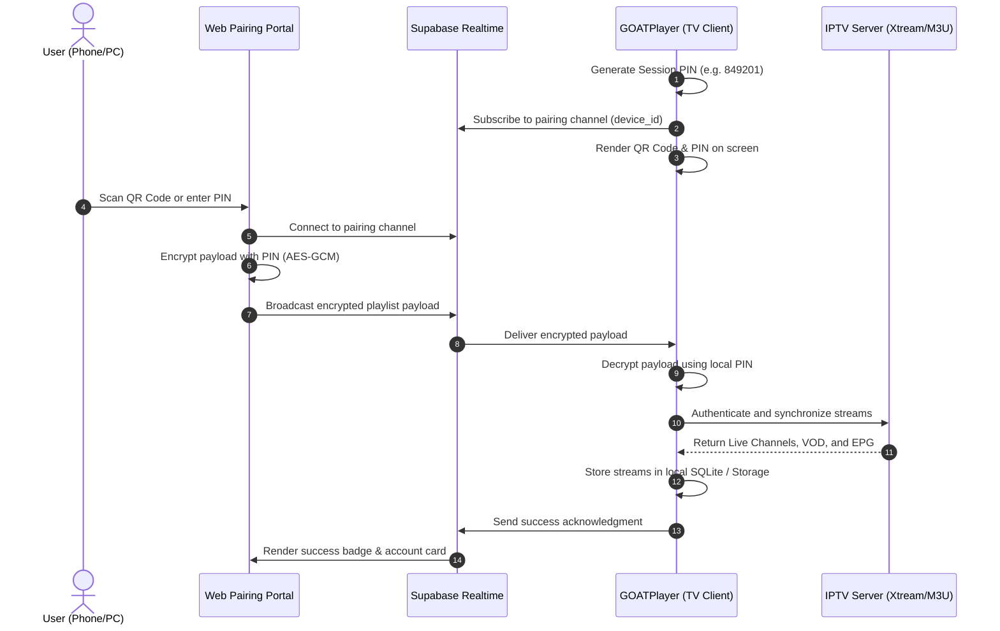

# 🏛️ ARCHITECTURE.md — GOATPlayer System Architecture

GOATPlayer implements a dual-stack system architecture designed to deliver maximum native hardware performance across modern desktop and mobile operating systems, while guaranteeing instantaneous responsiveness (<70ms focus latency) on low-powered Smart TV chips (ARM Cortex-A53/A7) where traditional heavy web frameworks experience stutter.

---

## 1. High-Level Architecture Diagram

```
                                  +---------------------------------------+
                                  |   Web Pairing Portal (Vercel)         |
                                  |   https://goat-player.vercel.app      |
                                  +-------------------+-------------------+
                                                      |
                                            Supabase Realtime
                                      (AES-GCM Zero-Knowledge Sync)
                                                      |
                         +----------------------------+----------------------------+
                         |                                                         |
                         v                                                         v
        +-----------------------------------+                     +-----------------------------------+
        |       FLUTTER CLIENT              |                     |      SMART TV CLIENT (Vanilla)    |
        |  Android TV, Fire TV, Mobile, Win |                     |    Samsung Tizen & LG webOS       |
        +-----------------------------------+                     +-----------------------------------+
        | - Presentation: Flutter Widgets   |                     | - Presentation: Vanilla HTML5/CSS |
        | - Overlays: tv_smart_iptv_overlay |                     | - Navigation: spatial_nav.js      |
        | - Remote: TvRemoteScope, TvFocus  |                     | - Video Engine: HTML5 + Hls.js    |
        | - Engine: media_kit (libmpv)      |                     | - Demuxer: TVContainerProber     |
        | - Database: Drift (SQLite WAL)    |                     | - Storage: storage.js (Sandboxed) |
        | - Sync: RemoteSyncService (Crypto)|                     | - Sync: sync.js (Web Crypto API)  |
        | - Network: Dio + Xtream Client    |                     | - Network: Native fetch() API     |
        +-----------------+-----------------+                     +-----------------+-----------------+
                          |                                                         |
                          +----------------------------+----------------------------+
                                                       |
                                                       v
                                     +-----------------------------------+
                                     |   IPTV Provider (Xtream / M3U)    |
                                     |  Live Streams, VOD, Series, EPG   |
                                     +-----------------------------------+
```

---

## 2. Platform Implementations

### 2.1 Native Flutter Client (`lib/`)

The native Flutter stack targets **Windows Desktop**, **Android Mobile / Tablets**, **Android TV**, and **Amazon Fire TV**.

- **Presentation Layer**:
  - **TV Leanback Mode**: Dedicated TV interface featuring `TvSmartIptvOverlays` (Smart IPTV style dual-drawer for live categories and channels with live EPG progress), `TvFocusable` for glowing active focus outlines, and `TvRemoteScope` for robust Back-key hierarchy.
  - **Mobile Touch Mode**: `MobileLiveView` with collapsible touch drawer, `MobileGestureDetector` for vertical volume/brightness swipes, and double-tap seeking.
  - **Desktop Mode**: Full multi-window support, hover volume controls, keyboard hotkeys, and split-screen category browsing.
- **Media Engine (`lib/core/player/`)**:
  - `media_kit` backed by `libmpv`.
  - Direct hardware-accelerated video rendering: Direct3D on Windows, MediaCodec on Android / Fire TV.
  - Multi-track audio and external subtitle demuxing with automatic language normalization (`TrackLanguageMatcher`).
  - Native aspect ratio letterboxing (`BoxFit.contain`).
- **Database Layer (`lib/core/database/`)**:
  - **Drift (SQLite)** compiled in Write-Ahead Logging (`WAL`) mode.
  - Asynchronous isolate-based transactions preventing frame drops during background synchronization of 20,000+ streams.
  - Modular DAOs: `StreamDao`, `AccountDao`, `EpgDao`, and `PlaybackProgressDao`.
- **Remote Pairing Service (`lib/core/remote_sync/`)**:
  - `RemoteSyncService` connects to Supabase Realtime via secure WebSocket channels.
  - **Zero-Knowledge Decryption**: Uses AES-GCM (256-bit) with PBKDF2 key derivation from the 6-digit TV PIN. The remote portal encrypts credentials in the browser, and the Flutter client decrypts them locally without the cloud database ever possessing the plaintext credentials.

---

### 2.2 Smart TV Web Application (`smart_tv/`)

The Smart TV stack targets **Samsung Tizen (2018+)** and **LG webOS (4.0+)**.

- **Zero-Framework Architecture**:
  - Built entirely with lightweight Vanilla JavaScript and CSS.
  - Total package size under 2MB; memory footprint below 60MB RAM.
- **Spatial Navigation Engine (`smart_tv/js/spatial_nav.js`)**:
  - 4-way D-Pad traversal algorithm calculating visual Euclidean distances between DOM focus nodes.
  - Boundary-aware navigation: Left-exit from the leftmost VOD card cleanly focuses the active category sidebar instead of wrapping vertically.
  - Dedicated 2D grid navigation for multi-column modal controls (Audio / Subtitle track selection).
  - Strict Back-key priority resolution: Closes open drawers -> exits fullscreen -> shows exit confirmation.
- **Video & Probing Engine (`smart_tv/js/player.js`)**:
  - Multi-tier playback fallback: HTML5 Native Video -> Hls.js -> Raw TS stream handling.
  - `TVContainerProber`: Low-overhead client-side byte-range reader parsing MP4 `mvhd` atoms to reliably determine true duration on Samsung Tizen TVs where `<video>.duration` reports `Infinity` or `NaN`.
  - Enforced `object-fit: contain` eliminating video stretching on 16:9 and 21:9 television panels.
- **Subtitles & Audio Engine (`smart_tv/js/subtitles.js`)**:
  - On-demand WebVTT and SRT subtitle parser with timestamp cue caching (`track.cues`).
  - Active cue renderer synchronized to HTML5 `timeupdate` events, rendering formatted subtitles in `#player-subtitle-overlay`.
- **Fault-Tolerant Sandboxed Storage (`smart_tv/js/storage.js`)**:
  - Wraps `window.localStorage` with an automatic in-memory fallback (`_memStore`) to guarantee uninterrupted operation in sandboxed widget environments (`file://` protocol) where local storage access throws `SecurityError`.

---

### 2.3 Web Pairing Portal (`portal/` & `https://goat-player.vercel.app`)

- **Zero-Typing Remote Management**:
  - Hosted static web application built with vanilla HTML/JS and Tailwind styling.
  - Generates QR codes pointing directly to the pairing URL with embedded device ID and session keys.
- **Zero-Knowledge Encryption**:
  - Implements the Web Crypto API (`crypto.subtle`).
  - Generates an AES-GCM 256-bit key derived via PBKDF2 (100,000 iterations) from the session PIN.
  - Payloads are encrypted on the client device before transmission across Supabase Realtime channels.
- **Smart Link Parser**:
  - Automatically deconstructs full Xtream Codes URLs (`http://server.com:8080/get.php?username=xxx&password=yyy&type=m3u_plus`) into separate Host, Username, Password, and Format fields.

---

## 3. Communication & Data Flow


